

  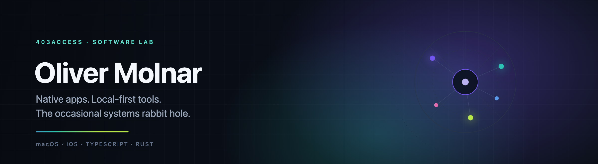

  I build software that runs on <b>your</b> machine: native Apple apps, local-first TypeScript and Rust tools, 
  and the occasional deep dive into the layer underneath.

  
  
  

> **Currently** — shipping **Optimizr**, building **Fitr** and **OpenCodeBar**, and writing up what **thousands of prompts** taught me about working with coding agents.

A few things I keep coming back to:

- **Local-first.** Your data stays on your machine. No account server in the middle.
- **Explainable.** Show the evidence, the severity and the fix — not just a scary number.
- **Native.** SwiftUI, AppKit and the system layer when it actually makes the product better.

## Selected work

<table width="100%">
<tr>
<td width="52%" valign="top">
  <a href="https://github.com/403access/optimizr">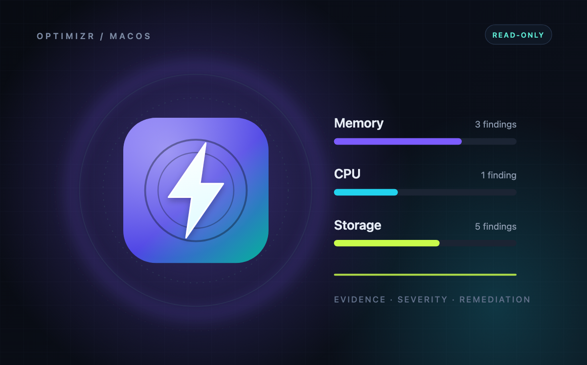</a>
</td>
<td width="48%" valign="top">
  <h3>Optimizr</h3>
  
<b>Find the drag. Fix the Mac.</b>

  
A native macOS audit across memory, CPU and storage that turns raw numbers into prioritized, explainable fixes. Every finding carries its evidence, severity, recoverable headroom and a reproducible remediation recipe.

  
Read-only by design: it never deletes, kills or changes anything behind your back.

  
<code>Swift</code> <code>SwiftUI</code> <code>macOS 14+</code> <code>MIT</code>

  
<a href="https://github.com/403access/optimizr">Repository</a> · <a href="https://403access.github.io/optimizr/">Website</a>

</td>
</tr>
</table>

 

<table width="100%">
<tr>
<td width="48%" valign="top">
  <h3>Fitr</h3>
  
<b>Train on your rhythm.</b>

  
A self-hosted fitness operating system: a 60-exercise catalogue with hand-authored vector animations, a daily plan across six time regions, Apple Health and GPS in one private picture, and a progress tracker that proves improvement week over week.

  
<code>SwiftUI</code> <code>iOS 18+</code> <code>Bun</code> <code>SQLite</code>

  
<a href="https://github.com/403access/fitr">Repository</a>

</td>
<td width="52%" valign="top">
  

    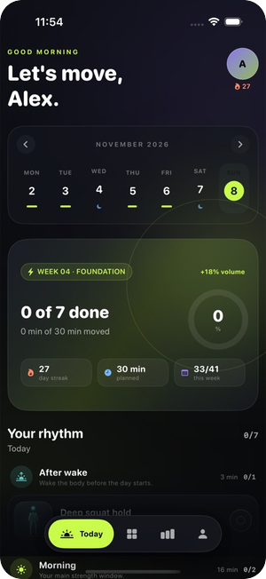
    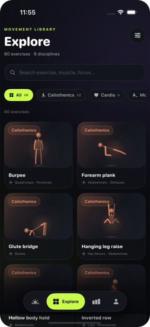
    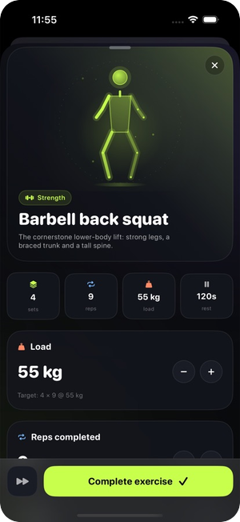
  

</td>
</tr>
</table>

 

<table width="100%">
<tr>
<td width="52%" valign="top">
  

    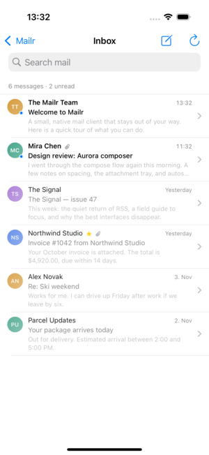
    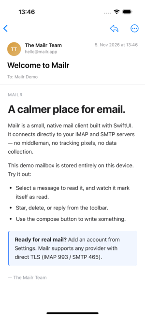
    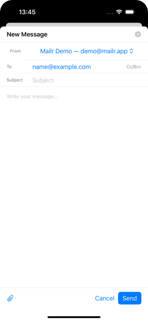
  

</td>
<td width="48%" valign="top">
  <h3>Mailr</h3>
  
<b>Mail, without the middleman.</b>

  
A native, privacy-first mail client for iPhone, iPad and Mac that speaks IMAP and SMTP directly. No proxy, no account server, no telemetry. An optional host archive runs on your own Mac and keeps every message on the origin server.

  
<code>Swift</code> <code>SwiftUI</code> <code>IMAP / SMTP</code> <code>iOS + macOS</code>

  
<a href="https://github.com/403access/mailr">Repository</a>

</td>
</tr>
</table>

 

<table width="100%">
<tr>
<td width="48%" valign="top">
  <h3>OpenCodeBar</h3>
  
<b>Watch your agent work.</b>

  
A native macOS menu bar app and iPhone/iPad companion for OpenCode: live sessions, prompts, per-project analytics, usage, Home Screen widgets, and remote control of the Mac. A small Bun + SQLite hub keeps one shared history.

  
<code>Swift</code> <code>SwiftUI</code> <code>Bun</code> <code>SQLite</code>

  
<a href="https://github.com/403access/ai-tools">Repository</a> · <a href="https://403access.github.io/ai-tools/docs/">Docs</a>

</td>
<td width="52%" valign="top">
  

    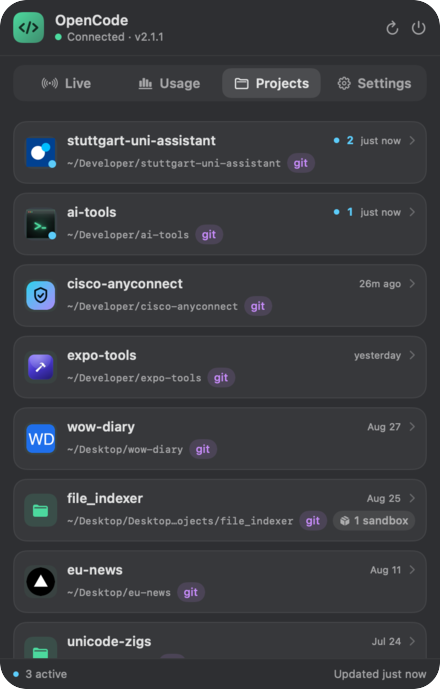
    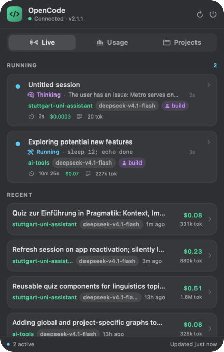
  

</td>
</tr>
</table>

 

<table width="100%">
<tr>
<td width="52%" valign="top">
  <a href="https://github.com/403access/mindme">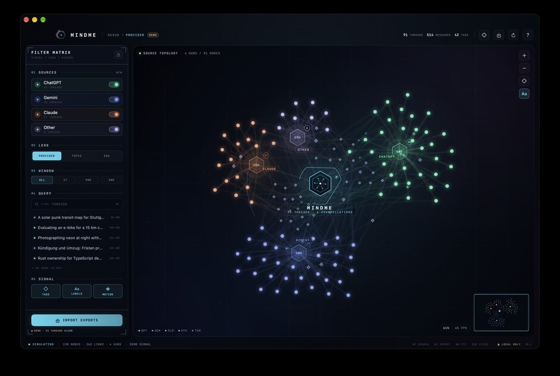</a>
</td>
<td width="48%" valign="top">
  <h3>MINDME</h3>
  
<b>A constellation of your AI conversations.</b>

  
A local-first 3D mind map for ChatGPT, Gemini, Claude and OpenCode archives. Topic lenses, provider topology, a cost overlay, live search, and a spatial mode that makes a very large conversation history feel navigable.

  
<code>Swift</code> <code>WebGL</code> <code>local-first</code>

  
<a href="https://github.com/403access/mindme">Repository</a>

</td>
</tr>
</table>

 

<table width="100%">
<tr>
<td width="48%" valign="top">
  <h3>Signal</h3>
  
<b>Root causes, not symptom storms.</b>

  
A causality-first monitoring console for NinjaOne: hierarchical conditions, priority-tuned alerts, downstream-noise suppression, external outage signals, AI triage, and a task workflow generated from real incidents.

  
<code>Bun</code> <code>React</code> <code>TypeScript</code> <code>NinjaOne API</code>

  
<a href="https://github.com/403access/NinjaOne-Monitoring">Repository</a>

</td>
<td width="52%" valign="top">
  <a href="https://github.com/403access/NinjaOne-Monitoring">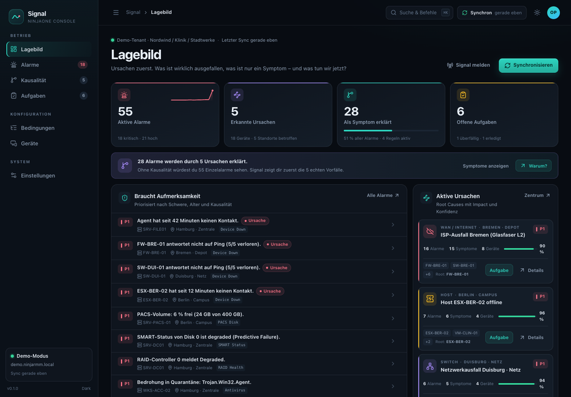</a>
</td>
</tr>
</table>

 

<table width="100%">
<tr>
<td width="52%" valign="top">
  

    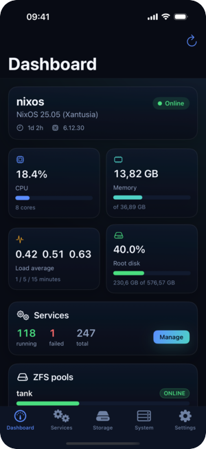
    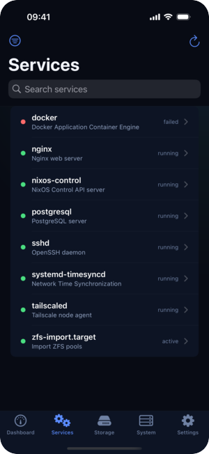
    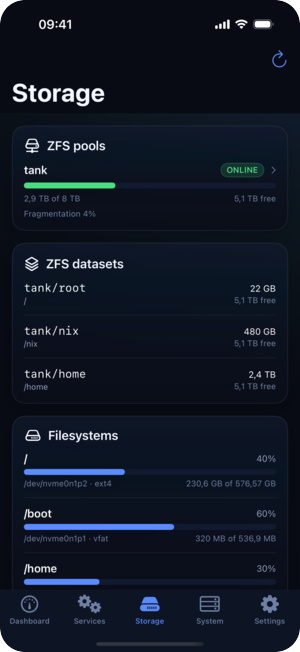
  

</td>
<td width="48%" valign="top">
  <h3>NixOS Control</h3>
  
<b>Your homelab, in your pocket.</b>

  
An iPhone app and a small authenticated host API for a NixOS machine: services, journal logs, ZFS pools, generations, rebuilds and reboots — reachable over Tailscale, never exposed to the open internet.

  
<code>Swift</code> <code>SwiftUI</code> <code>Rust</code> <code>Tailscale</code>

  
<a href="https://github.com/403access/nixos">Repository</a>

</td>
</tr>
</table>

 

<table width="100%">
<tr>
<td width="48%" valign="top">
  <h3>Downlink</h3>
  
<b>Resumable downloads. Local by default.</b>

  
A local-first media and file downloader built with pure Bun: HTTP range resume, curl import, live previews, batch mode and a clean library UI. Nothing routes through a third party.

  
<code>Bun</code> <code>TypeScript</code> <code>local-first</code>

  
<a href="https://github.com/403access/downlink">Repository</a> · <a href="https://403access.github.io/downlink/">Website</a>

</td>
<td width="52%" valign="top">
  <a href="https://github.com/403access/downlink">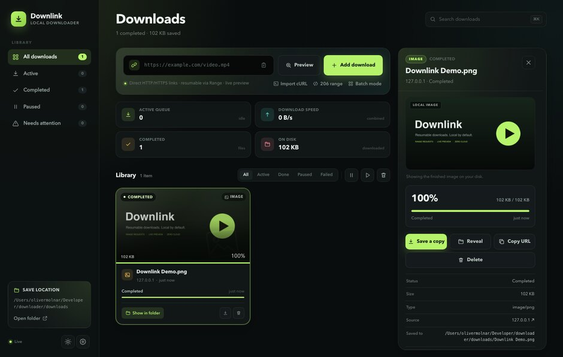</a>
</td>
</tr>
</table>

## More from the lab

<table width="100%">
<tr>
<td width="8%" valign="top"></td>
<td width="42%" valign="top">
  <b>Expo Tools</b> 
  A menu bar control room for Expo/Metro, Xcode and Android builds. 
  Swift · macOS
</td>
<td width="8%" valign="top"><a href="https://github.com/403access/ios-sim">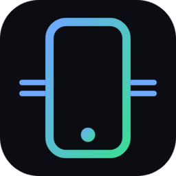</a></td>
<td width="42%" valign="top">
  <b>iOS Sim Bridge</b> 
  Run a real iOS Simulator from Linux over HTTP and WebSocket. 
  TypeScript · macOS host + CLI
</td>
</tr>
<tr>
<td valign="top"><a href="https://github.com/403access/macos-panel">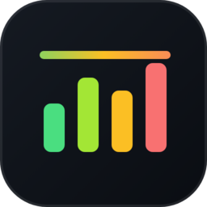</a></td>
<td valign="top">
  <b>macOS Panel</b> 
  CPU, RAM and free disk space, always visible in the menu bar. 
  Swift · macOS
</td>
<td valign="top"><a href="https://github.com/403access/macos-fixdisplay">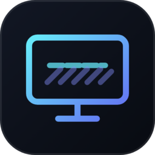</a></td>
<td valign="top">
  <b>FixDisplay</b> 
  Removes HDMI underscan borders and forces extended desktop mode. 
  Swift · macOS
</td>
</tr>
<tr>
<td valign="top"></td>
<td valign="top">
  <b>University Assistant</b> 
  Timetable, degree progress, course material, campus orientation and peer notes in one Expo app. 
  TypeScript · Expo · AGPL-3.0
</td>
<td valign="top"></td>
<td valign="top">
  <b>Managr</b> 
  A local desk for German company books: invoices, ledger, people and documents. 
  TypeScript · Next.js · SQLite
</td>
</tr>
<tr>
<td valign="top"></td>
<td valign="top">
  <b>Prompt Archaeology</b> 
  What thousands of prompts taught me about talking to a coding agent — plus seven skills. 
  JavaScript · data analysis
</td>
<td valign="top"></td>
<td valign="top">
  <b>File Indexer</b> 
  Index terabyte archives, find duplicates and near-duplicates, browse in a web UI. 
  Rust · SQLite
</td>
</tr>
<tr>
<td valign="top"></td>
<td valign="top">
  <b>Cisco AnyConnect</b> 
  Drive Cisco Secure Client from an Expo app through its URI handler. 
  TypeScript · Expo module
</td>
<td valign="top"><a href="https://github.com/403access/data-cloud-compare">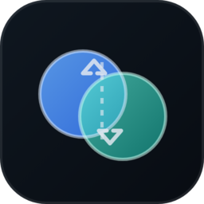</a></td>
<td valign="top">
  <b>Data Cloud Compare</b> 
  Verify cloud archives against a local index and browse both sides. 
  Python · SQLite · rclone
</td>
</tr>
</table>

  <b>Earlier work:</b> <a href="https://github.com/403access/SQLine">SQLine</a> · <a href="https://github.com/403access/WebNative">WebNative</a> · <a href="https://github.com/403access/inventory">inventory</a> · <a href="https://github.com/403access/trading-tax">trading-tax</a> · <a href="https://github.com/403access/trading-indicators">trading-indicators</a>

## Toolbox

  <b>Languages</b> 
  <code>Swift</code> <code>TypeScript</code> <code>Rust</code> <code>Python</code> <code>SQL</code>

  <b>Apple</b> 
  <code>SwiftUI</code> <code>AppKit</code> <code>WidgetKit</code> <code>CoreGraphics</code> <code>CoreSimulator</code>

  <b>Web &amp; data</b> 
  <code>Bun</code> <code>React</code> <code>Next.js</code> <code>SQLite</code> <code>Docusaurus</code> <code>Docker</code>

  <b>Systems</b> 
  <code>NixOS</code> <code>Linux</code> <code>Tailscale</code> <code>rclone</code> <code>Git</code>

---

  Local-first by default. No telemetry. If it doesn't exist, build it.

